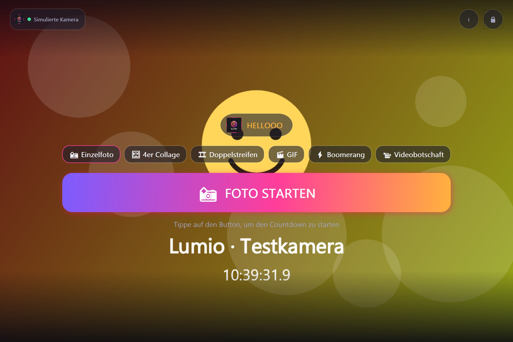
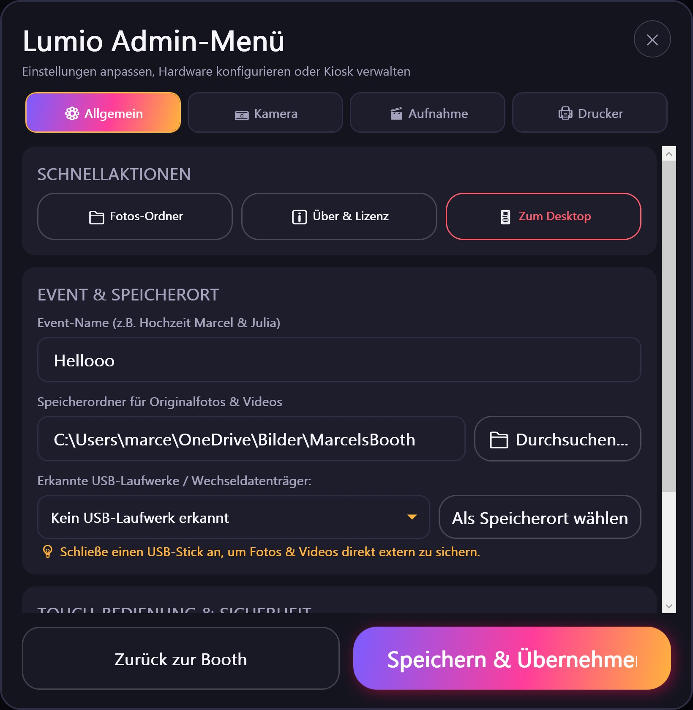

<p align="center">
  <a href="README.de.md">🇩🇪 Deutsch</a> &nbsp;|&nbsp; <a href="README.md"><b>🇬🇧 English</b></a>
</p>

<p align="center">
  
</p>

# Lumio 📸

A modern, touch-optimized photobooth software for Windows, Linux & Android. Built for parties, weddings, and events with DSLR/mirrorless cameras (**Nikon, Canon, Sony, Fuji**), webcams, and the **Canon Selphy** photo printer.

---

<p align="center">
  
</p>

---

## Why this project?

I used **dslrBooth** for my photo booth for years and was generally satisfied. Until they decided to overturn their licensing model – my license, which was originally bought as a "lifetime" license, suddenly became invalid and they demanded an expensive recurring subscription.

I was completely done with that. So I sat down and built my own photobooth software from scratch: **Lumio**. 
No subscriptions, no licensing headaches, no internet required at events, and fully designed for touch operation (especially for my Microsoft Surface and Raspberry Pi).

---

## New in Version 1.3.7: Ready for Google Play 🚀

- 📱 **New package name** `io.github.mazls.lumio` for the Play Store – please uninstall the old app once (photos are kept).
- 🟣 **Round Lumio logo** – also as an app icon filling the whole icon shape – and a **crisp background** even in 4K fullscreen.
- 📐 **Portrait layout** cleaned up: mode buttons at the top, "Start photo" at the bottom.
- 🔋 Battery saver on by default, live view no longer mirrored.

## New in Version 1.3.5: Looks & Beauty Filter 🎨

- 🎨 **Looks for guests**: Original, Sunny, Vivid, Glam B&W, Vintage or Cinema – one tap after the shot, the chosen look is saved and printed.
- ✨ **Beauty filter** (optional): gentle skin smoothing in three levels.
- 📷 **Nikon Z 50 II via PTP**: real full-resolution photos instead of video frames.
- 📱 **Selfie camera follows the screen orientation**, portrait photos get a portrait 10×15 card.
- 📂 **Photos on Android in "Pictures/Lumio"** – visible in Google Photos, deletable in the gallery with a PIN.

## New in Version 1.3.4: Webcams on Android & Gallery with Videos 🎥

- 📷 **Regular USB webcams on phones/tablets** (e.g. Anker PowerConf C200) – great for a low-cost tablet setup.
- 🖼️ **Videos, GIFs & boomerangs play in the gallery**.
- 📂 **One folder per event**, even when the party goes past midnight or over several days.
- 🔔 **Update notice** as soon as a new version is released on GitHub.
- ✨ **Twinkling fairy lights** in battery saver mode and edge-to-edge display on Android.

## New in Version 1.3.3: Selphy Printing Fixed 🖨️

- 🖨️ **Whole photo on the card**: The picture is now scaled to the 100×148 mm Selphy card (previously only a section was printed).
- ✂️ **Borderless printing** as an option in Admin menu → Printer.
- 📶 **Printing over Wi-Fi**: The Selphy is found in the network automatically – so the Android app can print now too.

## New in Version 1.3.2: Party Look ✨

- 🎨 **New test camera** with an animated party scene (fairy lights, bokeh, Lumio logo) – looks like a real photo booth even when testing without a camera.
- 🌙 **Resting screen in battery saver mode**: a cozy party still image instead of a black background, also around the camera picture in portrait mode.

## New in Version 1.3.1: Battery Saver & Portrait Mode 🔋

- 🔋 **Battery saver**: Live view only from the countdown on – the camera rests on the start screen. Especially with DSLRs the battery lasts a lot longer (Admin menu → Camera).
- 📱 **Portrait mode**: Lumio rotates with the device and has its own upright layout. In portrait the live view shows the whole camera frame across the full width.
- 📷 **Nikon D5600 on the phone** now runs smoothly: stable live view, autofocus before every shot, automatic reconnect and full resolution straight from the camera.

## New in Version 1.3.0: Lumio as an Android App 📱

I wanted my photo booth to work without a laptop too – just grab an old tablet or phone, plug the camera in via USB-C, done. And that's exactly what works now:

- 📱 **Lumio runs on Android**: Same UI and all modes as on Windows & Linux – single photo, 4-photo collage, double strip, GIF, Boomerang and video message.
- 📷 **Nikon Z 50 II via USB-C (UVC/UAC)**: Just plug it in – Lumio ships its own UVC driver and doesn't need Android to recognize the camera itself (Google Pixel phones, for example, don't). Smooth 30 FPS live view, and video messages use the camera's microphone as well.
- 📷 **Nikon D5600 via USB-OTG (PTP)**: Live view and real shutter release straight over USB.
- 🔌 **Plug in and go**: A connected camera automatically takes priority over the built-in phone cameras. Unplugged or swapped the camera? Lumio reconnects on its own.
- 🎬 **Video messages with sound as MP4**: Plays on every guest's phone.
- 🖥️ **Proper kiosk fullscreen**: No status bar, no navigation bar, screen stays on.

What came with 1.2.x (touch admin menu with tabs, on-screen keyboard, USB drive detection, native DSLR tethering) is listed in the **[CHANGELOG](CHANGELOG.md)**.

---

<p align="center">
  
</p>

---

## Feature Overview

- **📱 Touch-First Kiosk Mode**: Fullscreen UI with dark glassmorphism design, oversized touch targets, and smooth animations.
- **📸 6 Different Capture Modes**:
  - `Single Photo`: Fast single shot (4x6" / 10x15cm postcard format)
  - `4-Photo Collage`: 4 shots in a 2x2 grid on a 4x6" print
  - `Selphy Double Strip`: 3 poses duplicated side-by-side as a classic photo strip (ready to cut in half)
  - `GIF`: 4 poses with countdown, compiled into an animated 4-frame looping GIF
  - `Boomerang`: Rapid 1.3-second action burst looping forward and backward (Instagram style)
  - `Video Message`: Personal video and audio guestbook messages from guests (configurable duration in Admin)
- **👀 Intermediate Photo Review**: In multi-shot modes, guests see a quick full-screen preview of their last pose before the next countdown begins.
- **🔋 Battery Saver**: Optionally the live view only starts with the countdown – the camera rests while nobody is taking photos.
- **⚙️ Full DSLR Exposure Control**: Manually adjust shutter speed, aperture, ISO, white balance, and exposure compensation from the Admin menu.
- **🔒 Guest PIN Lockout**: Prevents guests from accidentally accessing Windows/Linux. The Admin area is protected by a PIN code (default: `1234`). Emergency shortcuts: `Esc` or `Ctrl + A`.
- **🖨️ Canon Selphy Direct Printing**: Auto-detects Canon Selphy printers (CP1300, CP1500, CP1200) and prints borderless 4x6" photos on demand or automatically after capture.
- **🖼️ Event Gallery**: Bottom-corner live thumbnail preview; tap to open a fullscreen gallery to browse all photos of the night with a reprint function.
- **100% Offline**: Works in basements, barns, or festival tents without Wi-Fi. All media is saved locally and organized by date and event name.

---

## Supported Hardware & Platforms

1. **Platforms & Operating Systems**:
   - **Windows (x64)**: Regular PCs, laptops & touchscreen all-in-ones (Windows 10 & 11)
   - **Microsoft Surface (win-arm64)**: Native ARM64 build for Surface Pro & Surface Laptop
   - **Linux PC (linux-x64)**: Arch Linux, CachyOS, Ubuntu, Debian, Fedora, etc.
   - **Raspberry Pi (linux-arm64)**: Raspberry Pi 4 & Raspberry Pi 5 (64-bit Raspberry Pi OS / Debian)
   - **Android (tablets & smartphones)**: Kiosk app with immersive fullscreen, always-on screen and touch controls (see [Android App](#android-app-))
2. **Cameras**:
   - **DSLR & Mirrorless Cameras**: Nikon, Canon, Sony, Fujifilm, Panasonic Lumix, Olympus
     - *Windows*: Via digiCamControl (free, MIT license) or direct PTP detection
     - *Linux*: Native via gphoto2
     - *Android*:
       - **Nikon D5600 via USB-OTG (PTP)**: Own C# PTP driver – releases the shutter, streams live view and pulls the photo straight onto the device. *(Tip: Turn on airplane mode on the camera so SnapBridge/Bluetooth doesn't block the USB port.)*
       - **Nikon Z 50 II via USB-C (UVC/UAC)**: Own UVC driver – 30 FPS live view and camera microphone for video messages, even on devices without built-in USB camera support (e.g. Google Pixel).
       - **Other USB webcams & HDMI grabbers** (e.g. Anker PowerConf C200): Anything that shows up as a UVC webcam with MJPEG or YUY2 – including older cameras with clean HDMI out via a $10-15 USB-C video capture dongle.
       - **Built-in cameras**: Front and rear camera of the tablet/phone.
   - **Webcams**: USB webcams (Logitech, Anker, etc.) and integrated Surface front/rear and tablet cameras
   - **Simulated Test Camera**: Built-in virtual camera with live timestamp for testing without hardware
3. **Printers**:
   - Canon Selphy CP1300 / CP1500 / CP1200 / CP1000 via Windows printer driver (USB or network), CUPS on Linux/Raspberry Pi, or directly over Wi-Fi (IPP) – automatically over Wi-Fi on Android

---

## Quick Start

### Download Pre-built Release (No installation required)
Simply grab the appropriate ZIP archive under **[Releases](https://github.com/mazls/lumio/releases)**:
- **`Lumio-win-x64.zip`** for standard Windows laptops and PCs
- **`Lumio-win-arm64.zip`** for Microsoft Surface with ARM/Snapdragon processors
- **`Lumio-linux-x64.zip`** for **Linux PCs** (CachyOS, Arch Linux, Ubuntu, Debian, Fedora, etc.)
- **`Lumio-linux-arm64.zip`** for **Raspberry Pi 4 / 5** (64-bit OS)
- **`Lumio-android.apk`** for **Android tablets & phones** (installation see [Android App](#android-app-))

No .NET runtime needs to be preinstalled, as all releases are fully self-contained.

#### Running on Linux (CachyOS, Arch, Ubuntu, or Raspberry Pi):
```bash
# On Arch Linux / CachyOS / Manjaro:
sudo pacman -S gphoto2 cups ffmpeg
sudo systemctl enable --now cups

# Or on Debian / Ubuntu / Raspberry Pi OS:
sudo apt update && sudo apt install -y gphoto2 cups ffmpeg

# Unpack release and run
unzip Lumio-linux-x64.zip -d lumio   # or Lumio-linux-arm64.zip on the Pi
cd lumio
chmod +x run-lumio.sh Lumio
./run-lumio.sh
```

---

## Android App 📱

Lumio is also available as an app for Android tablets and phones. **A Google Play Store release is planned** – until then you install the app by sideloading. Sounds more complicated than it is:

### Option 1: Directly on the device (easiest)
1. On the tablet/phone, download **`Lumio-android.apk`** from **[Releases](https://github.com/mazls/lumio/releases)**.
2. Tap the APK. The first time, Android asks whether your browser or file manager may **"install unknown apps"** – allow it.
3. Install, done.

### Option 2: Via developer options & debugging (from your PC)
Handy if you set up Lumio on several devices or build it yourself.

1. **Unlock developer options**: *Settings → About phone* → **tap "Build number" 7 times** (enter your PIN if asked).
2. **Turn on debugging**: *Settings → System → Developer options* →
   - turn on **USB debugging** if the device is connected to your PC by cable, or
   - turn on **Wireless debugging** if the USB port is needed for the camera (device and PC on the same Wi-Fi).
3. **Install ADB on your PC** ([Android SDK Platform-Tools](https://developer.android.com/tools/releases/platform-tools)).
4. **Connect**:
   ```powershell
   # Via USB cable: plug in the device and confirm the debugging prompt on the device
   adb devices

   # Via Wi-Fi: under "Wireless debugging" -> "Pair device with pairing code"
   adb pair 192.168.x.x:PAIRING-PORT PAIRING-CODE
   adb connect 192.168.x.x:PORT      # port is shown at the top under "IP address & port"
   ```
5. **Install**:
   ```powershell
   adb install -r Lumio-android.apk
   ```
   If you build from source, `install-android.bat` (or `build-android.ps1 -Install`) builds, installs and starts the app in one go.

> **Update fails ("App not installed")?** Then the old version was signed with a different key. Uninstall the old Lumio version and install again – **back up the photos of your last event first**, uninstalling deletes them.

### Connecting a camera
- **Nikon Z 50 II**: In the camera menu, set the USB connection to **UVC/UAC** (USB webcam) and plug it in via USB-C.
- **Nikon D5600**: Connect it with a USB-OTG adapter and turn on **airplane mode on the camera** (otherwise SnapBridge blocks the USB port). Set image quality to **JPEG** or **RAW+JPEG** – Lumio can't process RAW-only.
- The first time you plug the camera in, Android asks whether to open Lumio: **tap "Always"** – the USB prompt never comes back and the camera is ready instantly at every event.
- Lumio automatically uses the connected camera. Without an external camera it uses the device's front or rear camera; you can switch anytime in the admin menu under **Camera**.
- Simply allow camera and microphone access on first launch.

### Tips for events
- Keep the charger connected – with the camera on the USB-C port you'll need a USB-C hub with Power Delivery for that.
- Turn on the **battery saver** (Admin menu → Camera) – then the camera battery lasts the whole night too.
- Use Android's **"App pinning" (*Settings → Security*) so guests can't leave Lumio.

---

## How to Use

1. **Start**: Launch the application (`Lumio.exe` / `Lumio.bat` on Windows, `./run-lumio.sh` on Linux, app icon on Android).
2. **Open Admin Menu**: Tap the lock icon in the top-right corner (or keyboard: `Esc` / `Ctrl+A`) and enter your PIN (default: `1234`).
3. **Configure**:
   - **General**: Enter event name (e.g. "Wedding Sarah & Tom") and select the storage path. Enable the on-screen keyboard if needed.
   - **Camera**: Select camera (DSLR, webcam, or simulation) and adjust exposure settings.
   - **Capture**: Choose template and set up photo branding (logo / event text overlay).
   - **Printer**: Select printer and send a test print if desired.
4. **Party Mode**: Hand the booth over to your guests – they simply tap their desired mode on the touchscreen and strike a pose!

---

## For Developers

```powershell
# Clone repo
git clone https://github.com/mazls/lumio.git
cd lumio

# Run tests
dotnet test Lumio.slnx

# Build standalone locally (start-lumio.ps1 auto-detects x64 vs arm64)
powershell -ExecutionPolicy Bypass -File .\start-lumio.ps1 -Rebuild

# Build Android APK (ends up in publish-android\Lumio.apk):
powershell -ExecutionPolicy Bypass -File .\build-android.ps1
# or simply double-click build-android.bat

# Build the APK, install it on the connected device via ADB and start it:
.\install-android.bat
```

### Project Structure
- `src/Lumio.App`: WPF UI for Windows (touch kiosk, themes, dialogs)
- `src/Lumio.App.Shared`: Shared cross-platform Avalonia UI components (Views, Modals, Styles, Assets)
- `src/Lumio.App.Avalonia`: Desktop runner for Windows, Linux & Raspberry Pi
- `src/Lumio.App.Android`: Android app (.apk) for tablets & phones (PTP driver for the D5600, own UVC/UAC driver for the Z 50 II, Camera2, MP4 video messages, kiosk mode)
- `src/Lumio.Core`: Session flow, state machine, settings & storage logic
- `src/Lumio.Camera`: Multi-vendor DSLR drivers (Nikon, Canon, Sony via digiCamControl & gphoto2), webcams & test camera
- `src/Lumio.Imaging`: SkiaSharp 300-DPI collage renderer & GIF/Boomerang/video encoders
- `src/Lumio.Printing`: Canon Selphy spooler & CUPS integration
- `tests/Lumio.Tests`: 31 automated unit tests for Core, templates, collages, GIF & DSLR

---

## License & Third-Party Libraries 📜

Lumio is distributed under the **[Lumio Fair-Use & Event License](LICENSE)**:

- ✅ **Commercial Event Use ALLOWED:** You are completely free to use the compiled software at private parties and commercial events (e.g., photo booth rentals, weddings, corporate events, trade shows) and earn money with it. There are no hidden fees, licensing costs, or subscriptions.
- ❌ **Source Code Non-Commercial:** The source code is visible and may be used for personal purposes, learning, and contributions/improvements (Pull Requests). Commercial exploitation of the source code (e.g., reselling source code, creating commercial closed-source products or paid apps) is prohibited without prior written permission.

### Used Libraries & Licenses:
- **SkiaSharp** (Google Skia Wrapper) – MIT License
- **Avalonia UI** – MIT License
- **XamlAnimatedGif** – Apache-2.0 License
- **digiCamControl** (Camera Bridge) – MIT License (Copyright 2014 Duka Istvan)
- **gphoto2 & CUPS** – Invoked on Linux as external system utilities (GPL/LGPL/Apache)
- **Outfit Font** – SIL Open Font License 1.1

Check **[CHANGELOG.md](CHANGELOG.md)** for full release notes and version history.

Have fun partying and taking photos! 🍻
